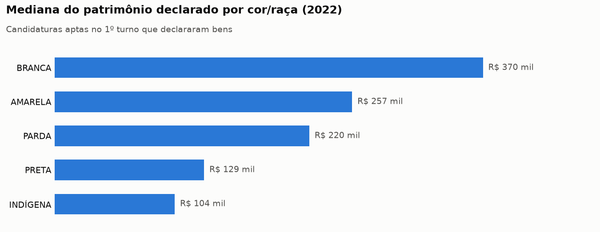
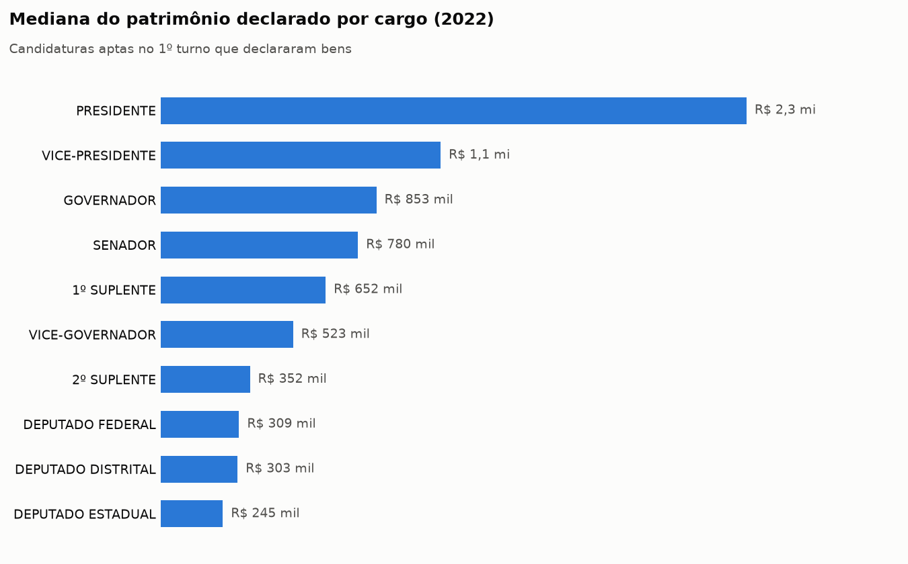
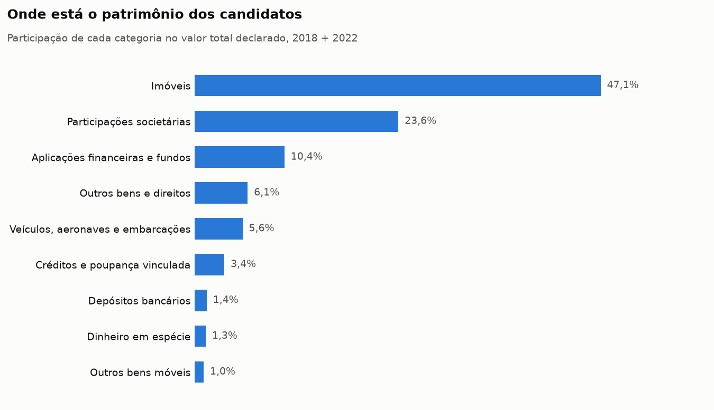
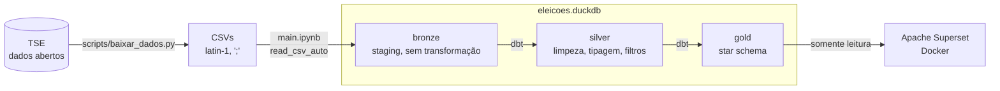
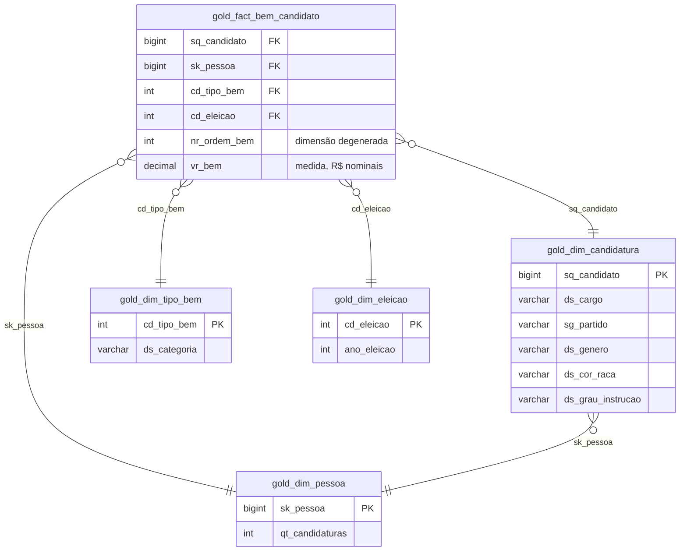

# Patrimônio dos candidatos nas eleições brasileiras

**Pipeline de dados ponta a ponta sobre os bens declarados ao TSE por 52 mil candidaturas nas
eleições gerais de 2018 e 2022**: dos CSVs brutos a um *star schema* testado e a um ambiente de BI
pronto para explorar.


| | |
|---|---|
| **Pergunta** | Quanto os candidatos declaram ter, onde está esse patrimônio e como ele se distribui por cargo, partido, gênero, cor/raça e escolaridade? Quem se candidatou nas duas eleições enriqueceu? |
| **Dados** | [Portal de Dados Abertos do TSE](https://dadosabertos.tse.jus.br/): 58,6 mil candidaturas e 186 mil bens declarados |
| **Entrega** | Arquitetura medalhão (bronze → silver → gold) em DuckDB + dbt, modelo dimensional com 1 fato e 4 dimensões, 35 testes de dados e Superset em Docker conectado ao banco |
| **Competências** | Modelagem dimensional, engenharia de dados com SQL, dbt (models, macros, testes, docs), qualidade de dados, BI, reprodutibilidade |

## Principais resultados

> R$ **43,7 bilhões** declarados por **52.343 candidaturas** aptas no 1º turno, somando
> **174.358 bens**.

- **Concentração extrema.** Em 2022, **1% das candidaturas concentra 51%** de todo o patrimônio
  declarado. Por isso as análises usam a mediana, e não a média.
- **Mais de um terço não declara nada.** 37% das candidaturas em 2018 e 36% em 2022 não
  informaram nenhum bem.
- **Desigualdade de gênero e raça.** Entre quem declarou bens em 2022, a mediana dos homens
  (R$ 330 mil) é **1,8 vez** a das mulheres (R$ 180 mil). A de candidatos brancos (R$ 370 mil) é
  **2,9 vezes** a de candidatos pretos (R$ 129 mil).
- **O cargo pesa.** A mediana vai de R$ 245 mil (deputado estadual) a R$ 853 mil (governador) e
  R$ 2,3 milhões (presidente).
- **Escolaridade.** Candidatos com ensino superior completo declaram mediana de R$ 372 mil, contra
  R$ 148 mil de quem tem ensino médio completo.
- **Partidos.** Entre os partidos com ao menos 100 candidaturas em 2022, NOVO (R$ 495 mil), PSD
  (R$ 450 mil) e PL (R$ 420 mil) têm as maiores medianas.
- **Evolução patrimonial.** 3.966 pessoas declararam bens nas duas eleições. Para elas, a variação
  mediana foi de **+22% em valores nominais**, abaixo da inflação acumulada no período (IPCA na
  casa de 25%). Ainda assim, **1 em cada 4 pelo menos dobrou** o patrimônio declarado.
- **Composição.** Imóveis (47%) e participações societárias (24%) somam mais de 70% do valor
  declarado.
- **A autodeclaração muda.** 1.197 pessoas declararam uma cor/raça diferente em 2018 e em 2022, o
  que orientou uma decisão do modelo (veja [Decisões técnicas](#decisões-técnicas)).

<picture>
  <source media="(prefers-color-scheme: dark)" srcset="docs/img/mediana_cor_raca_escuro.png">
  
</picture>

<picture>
  <source media="(prefers-color-scheme: dark)" srcset="docs/img/mediana_cargo_escuro.png">
  
</picture>

<picture>
  <source media="(prefers-color-scheme: dark)" srcset="docs/img/composicao_categoria_escuro.png">
  
</picture>

Os gráficos são gerados a partir da camada gold por [scripts/graficos.py](scripts/graficos.py).
Todas as consultas dos números acima estão no [main.ipynb](main.ipynb).

## Arquitetura



| camada | ferramenta | o que acontece |
|---|---|---|
| **bronze** | DuckDB + Python ([main.ipynb](main.ipynb)) | CSVs carregados como estão: uma área de staging que o dbt lê como *source* |
| **silver** | dbt ([models/silver](eleicoes/models/silver)) | 1º turno e candidaturas aptas, valores `"1234,56"` convertidos para `DECIMAL(18,2)`, bens sem tipo descartados |
| **gold** | dbt ([models/gold](eleicoes/models/gold)) | modelo dimensional pronto para análise |
| **BI** | Apache Superset ([superset/](superset)) | banco já cadastrado ao subir o container, SQL Lab e dashboards |

O DuckDB foi escolhido por ser um banco analítico colunar que roda no próprio processo: processa
centenas de milhares de linhas em segundos, sem servidor, e todo o banco fica em um único arquivo.

## Modelo dimensional



| tabela | grão | linhas |
|---|---|---|
| `gold_fact_bem_candidato` | um bem declarado por uma candidatura | 174.358 |
| `gold_dim_candidatura` | uma candidatura | 52.343 |
| `gold_dim_pessoa` | uma pessoa (derivada do CPF) | 46.609 |
| `gold_dim_tipo_bem` | um tipo de bem do TSE + macrocategoria | 50 |
| `gold_dim_eleicao` | uma eleição | 6 |

Documentação completa das colunas e regras em [starschema.md](starschema.md).

## Decisões técnicas

**Identificar a mesma pessoa em eleições diferentes.** O TSE liga candidatos e bens pelo
`SQ_CANDIDATO`, que muda a cada eleição. Para comparar 2018 com 2022, criei a chave substituta
`sk_pessoa` (macro [sk_pessoa.sql](eleicoes/macros/sk_pessoa.sql)): o hash do CPF ou, quando o
CPF não é divulgado (o TSE publica `-4`), o hash do `SQ_CANDIDATO`. O hash é deslocado em 1 bit
para caber num `BIGINT` com sinal, pois o `UBIGINT` nativo do DuckDB quebra a leitura via pyarrow no
Superset.

**Separar pessoa de candidatura.** Nome, gênero e cor/raça são declarados *a cada candidatura* e
mudam: 1.197 pessoas trocaram de cor/raça entre 2018 e 2022. Em vez de escolher arbitrariamente uma
versão, esses atributos ficam em `gold_dim_candidatura`, e `gold_dim_pessoa` guarda só a identidade.
Assim, qualquer comparação entre candidaturas da mesma pessoa é um *self-join* em `sk_pessoa`.

**Evitar dupla contagem.** Candidatos que disputam o 2º turno aparecem duas vezes no cadastro do
TSE, e candidaturas indeferidas também declaram bens. A camada silver mantém só o 1º turno e
situação `APTO`, e a fato só aceita bens de candidaturas presentes na dimensão.

**Macrocategorias de bens.** Os cerca de 50 códigos de tipo de bem do TSE são agrupados em 9
categorias (imóveis, veículos, participações societárias...) pelas faixas de código, que são estáveis
entre 2018 e 2022.

**Valores monetários exatos.** `VR_BEM_CANDIDATO` vem como texto com vírgula decimal e é convertido
para `DECIMAL(18,2)`, nunca `FLOAT`, para que somas de bilhões não acumulem erro de arredondamento.

**Schemas limpos.** A macro [generate_schema_name](eleicoes/macros/generate_schema_name.sql)
sobrescreve o padrão do dbt para os modelos irem para `silver` e `gold` (e não `bronze_silver`,
`bronze_gold`).

**BI reprodutível.** O Superset sobe com um `docker compose up`, com o banco DuckDB já cadastrado
em modo somente leitura. A imagem usa Python 3.12 e fixa o mesmo `duckdb==2.0.0` do projeto, porque
versões antigas do DuckDB não abrem arquivos gravados por versões novas.

## Qualidade de dados

`dbt build` roda os modelos e os **35 testes** na ordem do DAG:

- `unique` e `not_null` em todas as chaves;
- `relationships` da fato para cada dimensão (integridade referencial do star schema);
- testes SQL próprios que garantem o grão: nenhum bem duplicado por
  `(sq_candidato, nr_ordem_bem)` na silver e na gold.

As descrições das fontes, modelos e colunas estão nos `schema.yml` e geram um site navegável com o
grafo de linhagem: `dbt docs generate && dbt docs serve`.

## Como executar

Requisitos: [uv](https://docs.astral.sh/uv/) e, para o Superset, Docker.

```bash
uv sync                          # dbt, dbt-duckdb, duckdb e pandas
uv run scripts/baixar_dados.py   # baixa os CSVs nacionais do TSE para eleicoes/data/raw/
```

1. **Bronze:** execute o [main.ipynb](main.ipynb) até a seção 3. Ele cria o `eleicoes.duckdb` com
   as tabelas `bronze.candidatos` e `bronze.bens`.
2. **Silver e gold:** feche a conexão do notebook (`con.close()`; o DuckDB aceita um único processo
   de escrita) e rode

   ```bash
   cd eleicoes && uv run dbt build
   ```

3. **Gráficos do README (opcional):** `uv run scripts/graficos.py`
4. **Superset:** veja abaixo.

> O TSE republica os arquivos periodicamente, então os números podem variar um pouco em relação
> aos deste README.

### Superset

```bash
docker compose up -d --build     # primeira vez: alguns minutos para construir a imagem
```

Acesse http://localhost:8088 (usuário `admin`, senha `admin`). O banco **eleicoes** já vem
cadastrado e as tabelas de análise estão no schema `gold`.

Para cruzar fato e dimensões num único dataset, crie-o pelo **SQL Lab** (**Save → Save dataset**):

```sql
SELECT
    f.ano_eleicao, f.vr_bem,
    t.ds_tipo_bem, t.ds_categoria,
    c.nm_urna_candidato, c.ds_cargo, c.sg_uf, c.sg_partido,
    c.ds_genero, c.ds_cor_raca, c.ds_grau_instrucao, c.ds_ocupacao,
    f.sk_pessoa, f.sq_candidato
FROM gold.gold_fact_bem_candidato f
JOIN gold.gold_dim_candidatura c USING (sq_candidato)
JOIN gold.gold_dim_tipo_bem t USING (cd_tipo_bem)
```

<details>
<summary>Comandos e observações do Superset</summary>

```bash
docker compose logs -f superset   # logs
docker compose down               # para o Superset (gráficos e dashboards ficam no volume)
docker compose down -v            # para e apaga gráficos, dashboards e usuários
```

- O Superset só **lê** o `eleicoes.duckdb`. Depois de um `dbt build` os dados novos aparecem sem
  reiniciar; evite consultar no Superset enquanto o dbt está rodando.
- Se atualizar o duckdb no `pyproject.toml`, atualize também [superset/Dockerfile](superset/Dockerfile).
- Usuário, senha e `SECRET_KEY` padrão servem apenas para uso local. Para trocar, crie um `.env` na
  raiz com `ADMIN_PASSWORD=...` e `SUPERSET_SECRET_KEY=...` (gere com `openssl rand -base64 42`).

</details>

## Estrutura do repositório

```
├── main.ipynb                  staging (bronze) + consultas de análise
├── scripts/
│   ├── baixar_dados.py         download dos dados do TSE
│   └── graficos.py             gráficos do README
├── eleicoes/                   projeto dbt
│   ├── models/
│   │   ├── sources.yml         tabelas bronze
│   │   ├── silver/             limpeza e tipagem
│   │   └── gold/               star schema
│   ├── macros/                 sk_pessoa, generate_schema_name
│   └── tests/                  testes de grão
├── superset/                   imagem e inicialização do Superset
├── docker-compose.yml
├── starschema.md               documentação do modelo dimensional
└── docs/img/                   gráficos
```

## Limitações

- Valores **nominais**: comparar 2018 e 2022 sem correção pela inflação superestima o crescimento.
- É patrimônio **declarado** pelo próprio candidato, sem verificação. Imóveis costumam ser
  declarados pelo valor de compra, não de mercado.
- Em 2018 a descrição livre do bem (`ds_bem`) vem quase sempre como `#NULO`, então as análises
  usam o tipo do bem.
- Poucas pessoas sem CPF divulgado não podem ser acompanhadas entre eleições.

## Próximos passos

- Tabelas agregadas na gold (patrimônio por candidatura, incluindo quem não declarou bens, e
  evolução patrimonial entre eleições) para simplificar os dashboards.
- Correção monetária pelo IPCA.
- Cruzar com o resultado das eleições: os eleitos são mais ricos que os não eleitos?
- Incluir 2026 e mover a carga bronze do notebook para o dbt (`external` sources ou seeds).
- CI com GitHub Actions rodando `dbt build` a cada push.

## Autor

**Felipe Vasconcelos**: [LinkedIn](https://www.linkedin.com/in/SEU-USUARIO) ·
[GitHub](https://github.com/SEU-USUARIO) · [Portfólio](https://SEU-SITE)

Dados públicos do Tribunal Superior Eleitoral. Código sob a licença [MIT](LICENSE).
